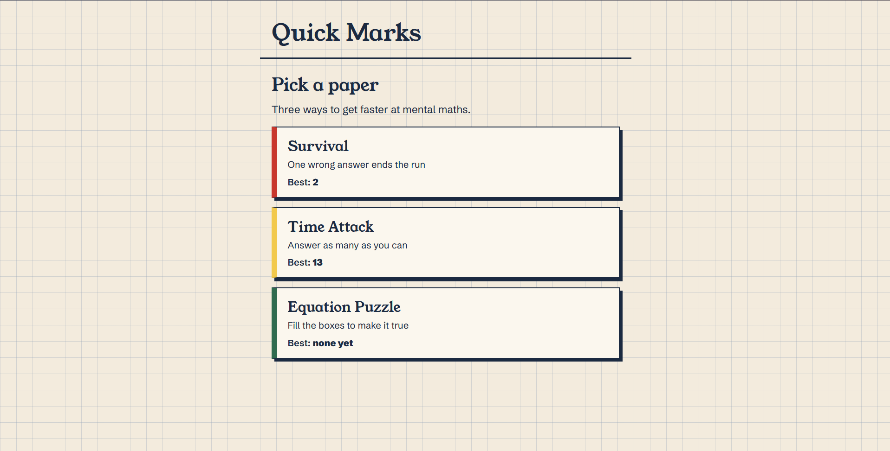
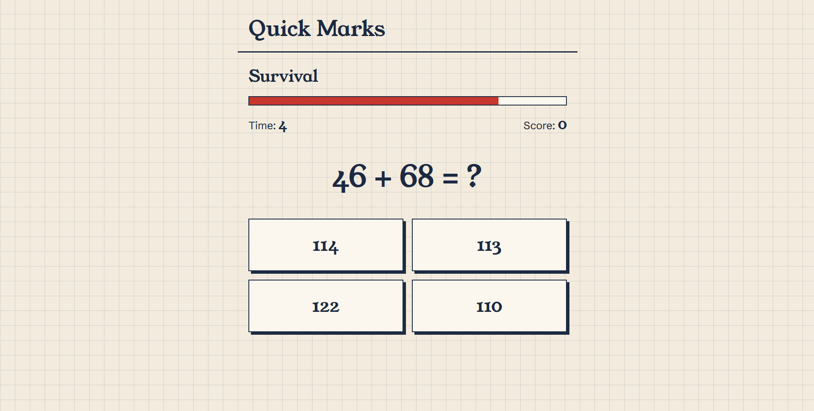
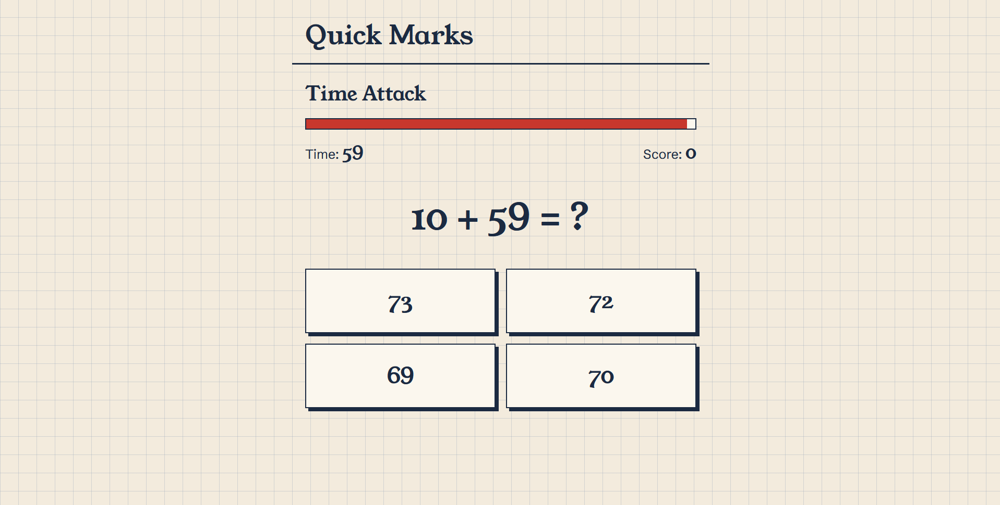
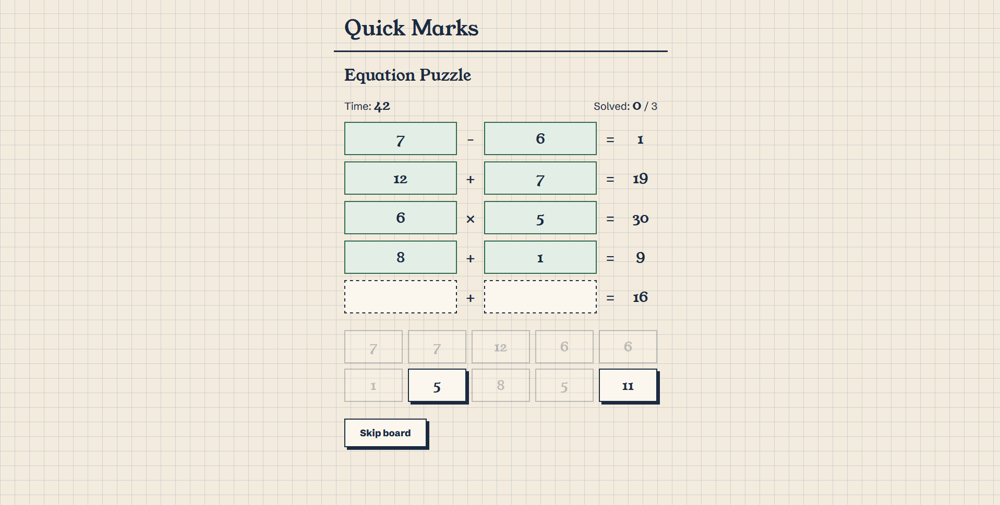
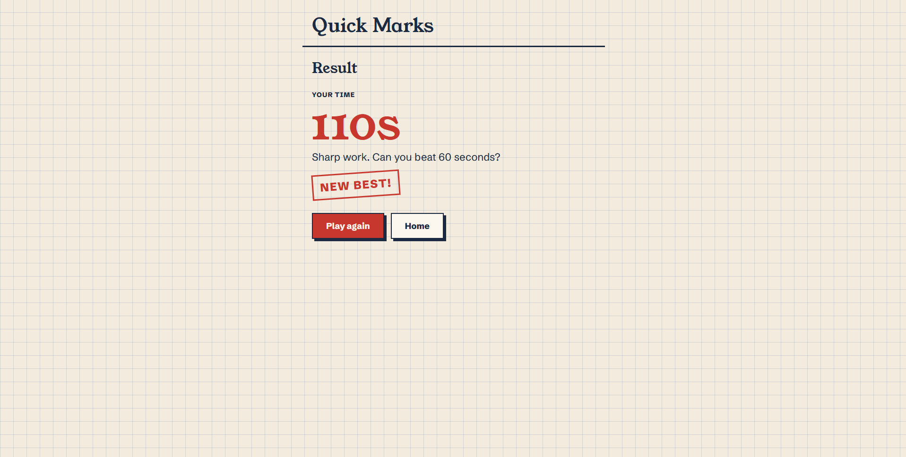

# Quick-Marks
A mental maths trainer with three timed games.
**Live demo:** [LIVE DEMO](https://nikhilkshub.github.io/Quick-Marks/)

## Screenshots
### Home

### Survival

### Time Attack 
 
### Equation Puzzle

### Result screen

## What it is
Quick Marks is a small website for practicing mental arithmetic under time pressure. You pick one of three games, choose a difficulty, and try to beat your own best score. The game have their respective best scores also and localstorage stores all the best score 

## The Reason
My main reason building it was because I myself struggle doing calculations mentally, I can easily do calculations like addition, subtraction, multiplication and division but I mostly myself get stuck in situations where i need to calculate very quickly and with proper accuracy and my main problems that I stuck with are the numbers or sums where the last digit is 6, 7, 8, or 9, like 26-17 or 28+37. For most of you this is kind of easy, even addition is easy for me but the main struggle is doing subtraction and also I dont have that much speed or quick thinking to solve all these so I made this platform to train myself also I learned various things myself building this platform, trying things, coming up with various ideas, getting inspirations, though there are platforms that exist for these type of things but making a platform yourself for you is kind of a different exciting thing so Yeah 

## The three games
**Survival.** One question at a time with four answer buttons or options. Each question has 5 seconds. A wrong answer or a timeout ends the run.

**Time Attack.** Answer as many questions as you can before the clock runs out. Pick 40 seconds, 60 seconds, 2 minutes, or type your own time (10 to 300 seconds). A wrong answer costs 2 seconds, so guessing does not pay.

**Equation Puzzle.** Five equations with empty boxes and ten number tiles containing numbers. Drag the tiles into the boxes so every equation is true. A row turns green when its maths is correct and red when it is not, and you can click a box to take a tile back. Solve 3 boards as fast as you can. A stopwatch counts up, and skipping a board adds 15 seconds. Your result is your total time, so lower is better.
Each board is built from the equations first and the tiles are made from their numbers, so every board can be solved. Division only uses numbers that divide evenly. The game checks the maths in each row rather than a stored answer, so any correct arrangement counts.

## Difficulty
| Level | Add and subtract | Times tables | Puzzle operators |
| --- | --- | --- | --- |
| Easy | up to 20 | up to 9 | + and - |
| Medium | up to 99 | up to 12 | + - and x |
| Hard | up to 999 | up to 15 | + - x and ÷ |

## Built with
- HTML, CSS and plain JavaScript
- No frameworks, no libraries, no build step
- Fonts: Young Serif and Schibsted Grotesk, loaded from Google Fonts
- Browser features used: `localStorage` for saved scores, and the built-in drag and drop events for the puzzle

## How to run it
There is nothing to install and no build or environment variables.
1. Download or clone the repository:
2. Open the `quick-marks` folder.
3. Double-click `index.html`. It opens in your browser and works straight away.

OR just try the live website link :- [LIVE DEMO](https://nikhilkshub.github.io/Quick-Marks/)

## How scores are saved
Your best score for each game is saved in your browser with `localStorage`, so it is still there when you come back. Survival and Time Attack keep the highest score and the Equation Puzzle keeps the lowest time. When you beat a record, the result screen shows a "New best!" stamp.
Scores are stored on your own device only. Clearing your browser's site data resets them.

## Known limits
- The Equation Puzzle uses drag and drop, so it needs a mouse. Touch screens cannot drag the tiles.
- The best score is shared across difficulty levels (and, in Time Attack, across time limits), so an Easy score and a Hard score compete.
- Scores are saved per browser and per address, so a new browser or a new web address starts empty.

## How it was made
I wrote the HTML, CSS and JavaScript myself while working through with the guidance from Claude(AI) also. It helped me in designing, reviewing idea, planning the features, and choosing the design. Wherever I got stuck or didnt know what to do or how to approach something I took help from Claude. He explained me concepts and ways to approach things also pointing out the limits, like the drag and drop feature in 'Equation Puzzle' game will only work in pc with a mouse and a touchscreen wont allow that feature so basically the platform is only for PC users right now maybe if I feel need for a mobile version then I can think about the other feature to handle that issue but for now its working fine. Pointing out the Bugs or repetitive codes and also giving me advice on how a common function can do multiple things instead of writing code for everything specifically.
